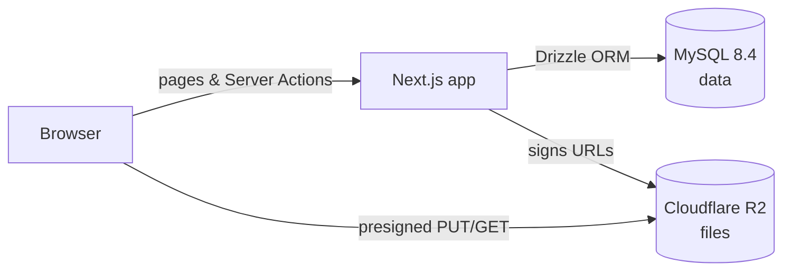
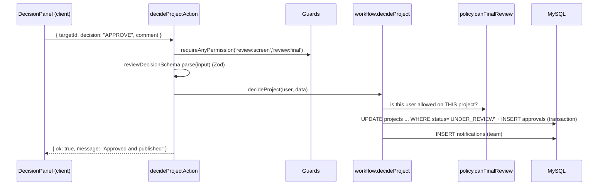
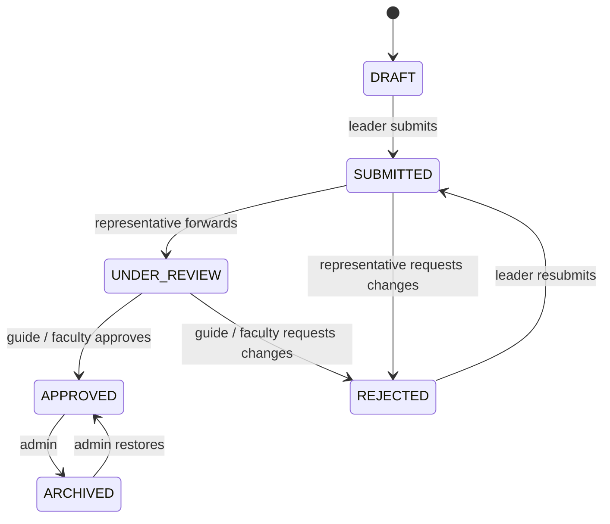

# Architecture

## The big picture

ErHub is a single Next.js application. The same codebase renders pages on the server, runs the business logic and talks to the database. There is no separate backend server to deploy.



- **Pages** are React Server Components. They run on the server, read the database directly and send HTML.
- **Mutations** (create, edit, submit, approve and so on) are **Server Actions**: functions marked `'use server'` that the browser calls like normal functions.
- **Files** never pass through our server. The browser uploads straight to R2 using a short-lived signed URL.

## Folder structure

```
src/
├── app/                      Routes (URLs). Thin: load data, render components.
│   ├── page.tsx              Landing page  /
│   ├── projects/             Public repository  /projects, /projects/[slug]
│   ├── (site)/               Public pages sharing the site header
│   │   ├── technologies/     /technologies, /technologies/[slug]
│   │   ├── [year]/[username] Student profile  /2026/abinantony
│   │   └── faculty/[username]Faculty profile  /faculty/meeranair
│   ├── (auth)/               /login, /register
│   ├── (dashboard)/          Signed-in area (sidebar layout, requireUser)
│   │   ├── dashboard/        /dashboard, /dashboard/projects, /dashboard/reviews, ...
│   │   └── admin/            /admin/* (admins only)
│   └── api/                  auth endpoints, access-checked file downloads
├── actions/                  Server Actions: the only entry points for mutations
├── features/                 Business logic, grouped by feature
│   ├── projects/             policy.ts, service.ts, workflow.ts, revisions.ts, queries.ts, components/
│   ├── reviews/              review queues + decision panel
│   ├── repository/           search, filters, project cards data
│   ├── files/                upload service + file manager UI
│   ├── notifications/        notify() service, bell, email stub
│   ├── admin/ analytics/ catalog/ profiles/ account/
├── components/
│   ├── ui/                   shadcn/ui primitives (our own copy, so we can edit them)
│   ├── shared/ site/ dashboard/ navigation/ forms/ motion/
├── db/                       Drizzle schema, relations, migrations, seed
├── lib/                      auth, env, errors, validation (Zod), storage, security
├── types/                    shared types (derived from the schema)
├── auth.ts                   Auth.js configuration
└── proxy.ts                  Next.js 16 proxy (formerly "middleware")
```

**Why `/dashboard/*` and not `/student`, `/faculty`?** A representative is also a student, and `/faculty/[username]` is a public profile. One dashboard whose sidebar adapts to the user's permissions avoids duplicate pages and URL clashes.

## How a request flows (example: a reviewer approves a project)



Every mutation follows the same steps: **authenticate → validate → authorize (policy) → change data in a transaction → notify → revalidate**. The shared `runAction()` wrapper turns errors into a consistent `{ ok, error, fieldErrors }` result.

## Layers and rules

| Layer | May import | Must not |
| --- | --- | --- |
| `app/` pages | features, components, lib | contain business rules |
| `actions/` | features, lib | be called from the server (they are for the client) |
| `features/*/service.ts` | db, lib, policy | trust user input without validation |
| `features/*/policy.ts` | nothing but rbac | touch the database (pure functions) |
| `components/` | ui, lib/format | import `@/db` or anything server-only |

## Project lifecycle



Once a project is **APPROVED**:
- **Light edits** (links, technologies, images, documents) go live immediately and are written to the audit log.
- **Major edits** (title, abstract, description, department, year, team) become a **revision** that goes through the same two-stage review. The approved version stays public until the revision is approved.

## Why these technologies?

| Choice | Reason |
| --- | --- |
| **Next.js (App Router)** | One codebase for UI and server logic; server rendering makes the public repository fast and indexable; Server Actions remove the need for a hand-written REST API. |
| **TypeScript** | Mistakes like a misspelt status or a missing field are caught before the code runs. |
| **MySQL** | A proven relational database for strongly related data (users, projects, members, approvals) with foreign keys and transactions. It runs anywhere, including a college server. |
| **Drizzle ORM** | Schema written in TypeScript, so the database types *are* the app types. SQL-like queries that students can read, with no hidden magic, plus versioned migrations. |
| **Auth.js** | A maintained, well-reviewed authentication library, so we don't write our own session or cookie crypto. |
| **Zod** | One schema both validates input on the server and powers form validation in the browser. |
| **Tailwind + shadcn/ui** | Accessible components (Radix) whose source lives in our repo, so the team can change them. The theme is defined entirely by CSS variables. |
| **GSAP** | Smooth, interruptible animations with built-in reduced-motion handling (`gsap.matchMedia`). |
| **Cloudflare R2** | S3-compatible object storage with no egress fees. Large files stay out of MySQL, and the S3 API means we can switch to MinIO or AWS later. |
| **Docker (dev MySQL)** | Every team member gets the same database version with one command. |

## Theming

All colours are CSS variables in [src/app/globals.css](../src/app/globals.css): `:root` for light mode and `.dark` for dark mode. To change the brand colour, edit `--primary` (and `--ring`, `--chart-1`) in both blocks. Every component follows.
