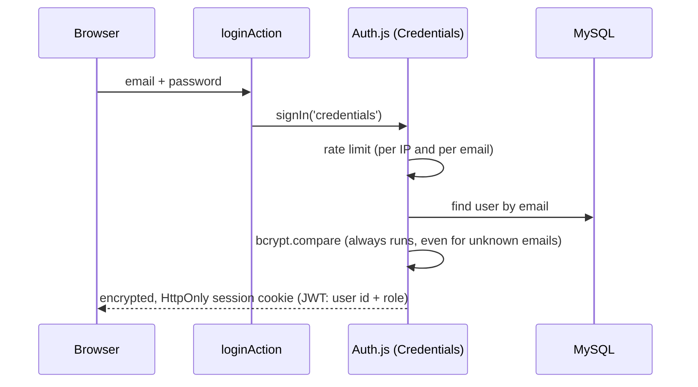

# Authentication & authorization

## Who can sign up

- **Students register themselves** at `/register` and always get the `STUDENT` role. Set `ALLOWED_EMAIL_DOMAIN` in `.env` to accept only college emails.
- **Admins promote** users to `REPRESENTATIVE`, `FACULTY` or `ADMIN` at `/admin/users`, and set their department.
- The first admin comes from the seed script (`admin@erhub.dev`).
- Forgotten passwords are reset by an admin for now; email-based reset will come with email support.

## How sign-in works



- Library: **Auth.js v5** (NextAuth) with the Credentials provider, configured in [src/auth.ts](../src/auth.ts).
- Passwords are hashed with **bcrypt** (cost 12). Plain passwords are never stored or logged.
- The session is a **JWT in an encrypted, HttpOnly, SameSite cookie**. JavaScript can't read it, and it is signed and encrypted with `AUTH_SECRET`.

### Auth identity vs the `users` table

Auth.js only proves *who* you are and stores your **user id** in the cookie. Everything else (role, department, active flag) lives in our `users` table. On **every request** `getCurrentUser()` reloads the user from MySQL, so:

- a deactivated user is signed out on their next click, and
- a promotion or demotion takes effect immediately, not when the cookie expires.

There are no Auth.js `accounts` or `sessions` tables, because they aren't needed with credentials and JWT sessions.

### Why not Better Auth or our own JWT code?

The original code signed its own JWTs. Hand-written session code is a common source of security bugs, so we use a maintained library instead. Auth.js was the team's preferred choice in the brief, and it integrates directly with Next.js.

## Authorization: three layers

| Layer | File | Purpose |
| --- | --- | --- |
| 1. Proxy | [src/proxy.ts](../src/proxy.ts) | Fast redirect: no cookie → `/login`; non-admin on `/admin` → `/dashboard`. **Convenience only.** |
| 2. Guards | [src/lib/auth/guards.ts](../src/lib/auth/guards.ts) | `requireUser()`, `requirePermission('review:final')` at the top of every protected page, layout and action. |
| 3. Policy | [src/features/projects/policy.ts](../src/features/projects/policy.ts) | Object-level checks: *may this user edit **this** project?* Stops IDOR. |

### Permissions (RBAC)

Code checks **permissions**, never role names directly ([rbac.ts](../src/lib/auth/rbac.ts)):

| Permission | Student | Representative | Faculty | Admin |
| --- | :-: | :-: | :-: | :-: |
| `project:create`: create and lead projects | ✔ | ✔ | | ✔ |
| `review:screen`: screen SUBMITTED projects | | ✔ | | ✔ |
| `review:final`: approve or reject UNDER_REVIEW projects | | | ✔ | ✔ |
| `project:guide`: be chosen as guide | | | ✔ | ✔ |
| `admin:*`: users, catalogue, projects, audit, analytics | | | | ✔ |

### Project-level rules (policy)

| Action | Who |
| --- | --- |
| View | Anyone if APPROVED; otherwise the team, the guide, department reviewers (not drafts) and admins |
| Edit content | Team members while DRAFT or REJECTED (locked during review) |
| Light edits after approval | Team members (go live, audited) |
| Manage team, choose guide, submit, delete draft | Leader only |
| Propose revision | Team members (team changes: leader only) |
| Screen | Representative of the **same department**, not a team member |
| Final decision | The **guide** if set, otherwise faculty of the same department; never a team member |

When a user isn't allowed, pages return **404** rather than 403 wherever possible, so private project ids aren't confirmed to exist.

## Using it in new code

```ts
// A page
export default async function Page() {
  const user = await requirePermission('review:final');
  // ...
}

// A Server Action
export async function doThing(input: unknown) {
  return runAction(async () => {
    const user = await requireUser();
    const data = mySchema.parse(input);
    const project = await getPolicyProject(data.projectId);
    if (!canEditContent(user, project)) throw new ForbiddenError();
    // ...
  });
}
```
